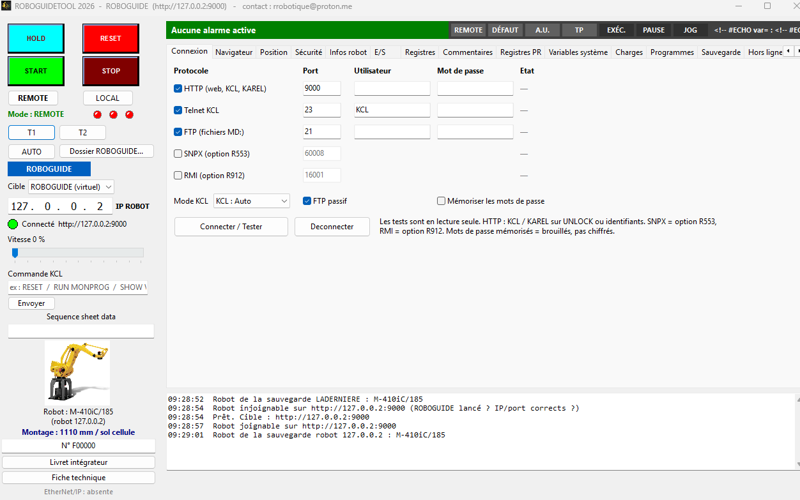

# ROBOGUIDETOOL 2026

Outil Windows pour les robots FANUC, **en lecture seule** : il lit une sauvegarde (MD) ou le robot lui-même et en sort un audit complet en HTML.

## Ce que fait l'outil

- Fiche robot, registres, outils et repères, programmes et arbre des appels
- Zones Space et DCS en 3D, cohérence Space / DCS, équations Safe I/O affichées en schéma
- Fiche de communication (EtherNet/IP, PROFINET), signaux UOP, logique de fond
- Contrôles des programmes : labels, sauts, WAIT sans TIMEOUT, références croisées des registres et des E/S
- Charges utiles, compteurs horaires, alarmes récurrentes, batteries
- Connexion au robot ou à ROBOGUIDE par HTTP, KCL, FTP (SNPX et RMI en option)

Aucune écriture sur le robot, aucune action sur la sécurité DCS.

## État du projet

Projet en cours de développement. Ce dépôt sert pour l'instant de présentation : le but est de recueillir des avis avant d'aller plus loin.

## Retours

Vos remarques et idées sont les bienvenues :

- par les [Issues](../../issues) de ce dépôt
- par e-mail : rrobotique@proton.me

---

FANUC et ROBOGUIDE sont des marques de FANUC Corporation. Cet outil est un projet indépendant, sans lien avec FANUC.
